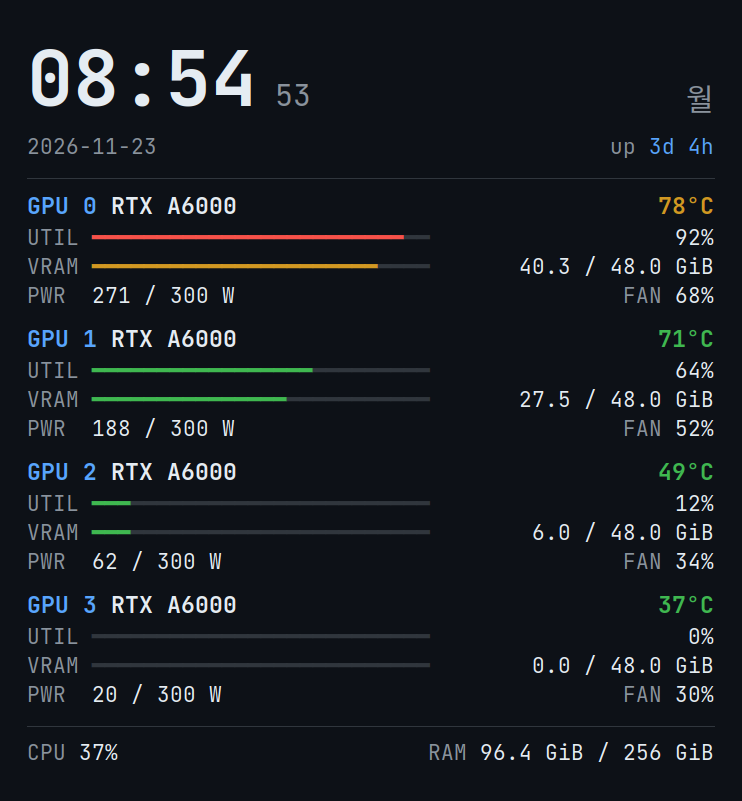

# conky-gpu-deck

NVIDIA 워크스테이션용 Conky 바탕화면 위젯입니다. 시각과 함께 GPU별 사용률, VRAM, 온도, 전력, 팬 속도를 실시간으로 보여줍니다.

[English](README.md)



## 기능

- 시각, 날짜, 가동 시간, CPU 부하, RAM 사용량 표시
- NVIDIA GPU 개수 자동 감지
- 부하와 온도를 정상, 주의, 위험 색상으로 구분
- VRAM 온도를 제공하는 GPU에서는 VRAM 온도 표시
- 1080p, 1440p, 4K 해상도에 맞춰 크기 조정
- Lua나 Cairo 빌드 없이 기본 `conky-std` 패키지로 동작

## 요구 사항

- X11 세션의 Linux
- `conky` 1.12 이상 (1.12.2에서 테스트)
- `nvidia-smi`가 포함된 NVIDIA 드라이버
- 권장 글꼴: JetBrains Mono, Noto Sans CJK

## 설치

```sh
git clone https://github.com/wnghdcjfe/conky-gpu-deck.git
cd conky-gpu-deck
./install.sh
conky -c ~/.conky/conky-gpu-deck/gpu-deck.conf
```

로그인할 때 자동으로 실행하려면 `./install.sh --autostart`를 사용하세요. 제거할 때는 `./uninstall.sh`를 실행합니다.

## 설정

자동으로 정해진 크기를 바꾸려면 `GPU_DECK_SCALE`을 지정합니다.

```sh
GPU_DECK_SCALE=1.25 conky -c ~/.conky/conky-gpu-deck/gpu-deck.conf
```

위치, 색상, 투명도는 `~/.conky/conky-gpu-deck/gpu-deck.conf`의 `conky.config`에서 바꿀 수 있습니다. 다시 설치해도 수정한 파일은 유지되고, 새 버전은 `gpu-deck.conf.new`로 저장됩니다.

## VRAM 온도

많은 NVIDIA GPU가 `nvidia-smi`로 메모리 온도를 제공하지 않습니다. 이런 GPU에서는 VRAM 온도를 숨기고 GPU 코어 온도를 항상 표시합니다.

## 개발

```sh
sh tests/run.sh
GPU_DECK_SAMPLE=tests/fixtures/sample.csv conky -c gpu-deck.conf
```

## 라이선스

[MIT](LICENSE)
