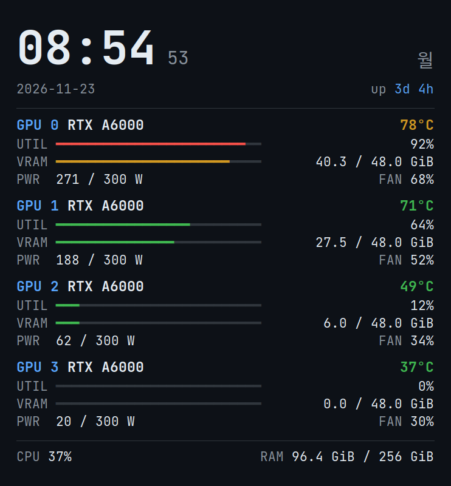

# conky-gpu-deck

A clean Conky desktop widget for NVIDIA workstations. It shows the time plus live utilization, VRAM, temperature, power, and fan speed for every GPU.

[한국어](README.ko.md)



## Features

- Shows the clock, date, uptime, CPU load, and RAM usage
- Detects any number of NVIDIA GPUs automatically
- Color-codes load and temperature as normal, warning, or critical
- Shows VRAM temperature on GPUs that report it
- Scales for 1080p, 1440p, and 4K displays
- Runs on the standard `conky-std` package, with no Lua or Cairo build needed

## Requirements

- Linux with an X11 session
- `conky` 1.12 or newer (tested with 1.12.2)
- NVIDIA driver with `nvidia-smi`
- Recommended fonts: JetBrains Mono and Noto Sans CJK

## Install

```sh
git clone https://github.com/wnghdcjfe/conky-gpu-deck.git
cd conky-gpu-deck
./install.sh
conky -c ~/.conky/conky-gpu-deck/gpu-deck.conf
```

Use `./install.sh --autostart` to start the widget at login. Run `./uninstall.sh` to remove it.

## Configuration

Set `GPU_DECK_SCALE` to override the automatic size:

```sh
GPU_DECK_SCALE=1.25 conky -c ~/.conky/conky-gpu-deck/gpu-deck.conf
```

Position, colors, and opacity are in the `conky.config` table of `~/.conky/conky-gpu-deck/gpu-deck.conf`. Reinstalling keeps your edited file and saves the new version as `gpu-deck.conf.new`.

## VRAM temperature

Many NVIDIA GPUs do not expose memory temperature through `nvidia-smi`. The widget hides the VRAM temperature on those cards and always shows the GPU core temperature.

## Development

```sh
sh tests/run.sh
GPU_DECK_SAMPLE=tests/fixtures/sample.csv conky -c gpu-deck.conf
```

## License

[MIT](LICENSE)
